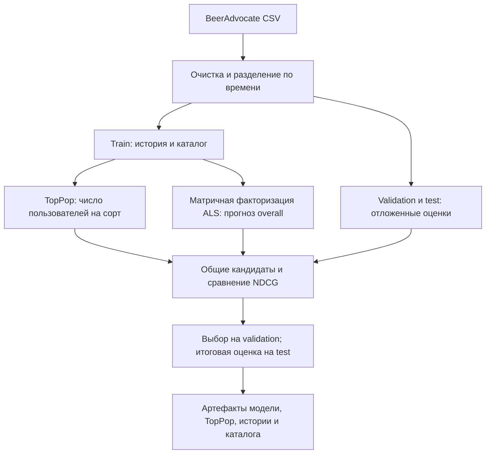
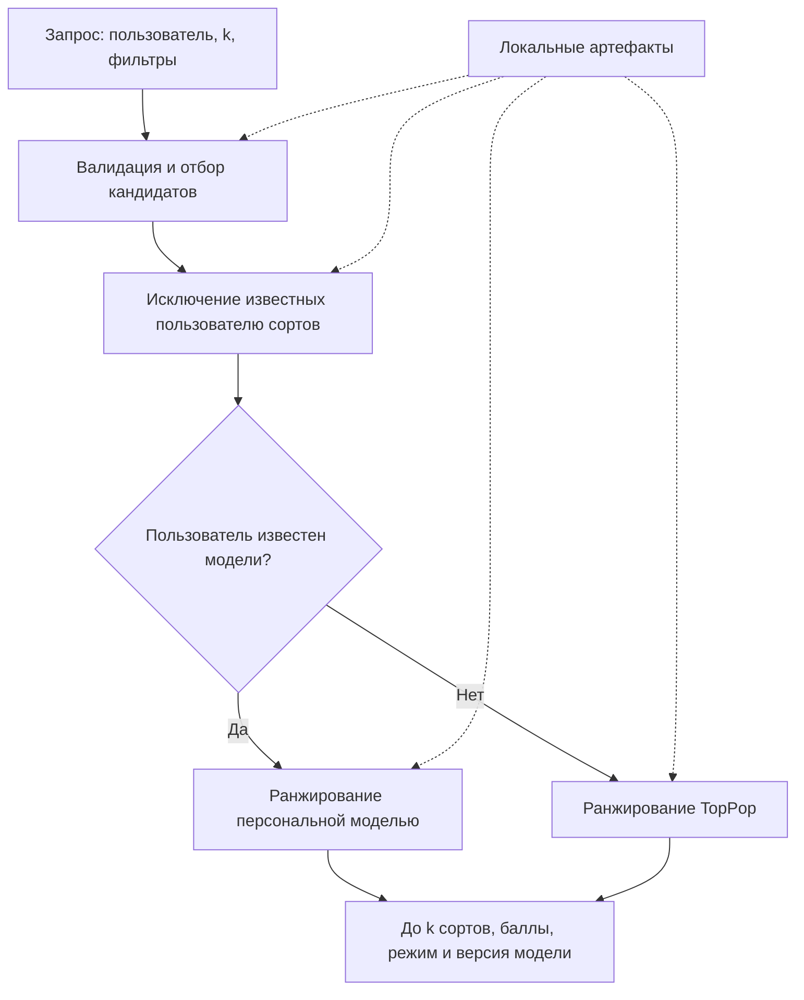

# ML System Design: beer4rec

**Итерация:** учебный MVP. **Версия:** 0.2, ДЗ1. **Дата:** 29.10.2026.

Требования ниже — допущения учебного проекта. Проверка модели на исторических данных
не заменяет будущий эксперимент с реальными пользователями.

## 1. Цели и предпосылки

### 1.1. Зачем идём в разработку продукта

#### Бизнес-цель и текущий процесс

[BeerAdvocate](https://www.beeradvocate.com/) — сообщество любителей пива: можно оставить
отзыв, почитать впечатления остальных и найти интересный сорт. На публичной главной
странице доступны общие подборки «Топ нового» и «В тренде»; пользователь самостоятельно
просматривает карточки и сопоставляет их со своим опытом.

Цель beer4rec — упростить выбор новых для пользователя сортов с высокой ожидаемой
персональной оценкой. Проектируемый результат — блок «Рекомендуем вам» в каталоге.

#### Почему предполагается польза от ML

В истории есть пользователь, сорт и пять отдельных оценок, по которым можно находить
сходство предпочтений. **Гипотеза:** персональная модель ранжирует интересные пользователю
сорта лучше, чем неперсональный TopPop; её нужно проверить на отложенных данных.

#### Что считаем успехом

Для продукта важна доля выбранных рекомендаций, впоследствии оценённых не ниже 4.
Успех учебного MVP — превзойти TopPop по NDCG@10 на офлайн-проверке по времени,
описанной в разделе 2.1; роста продуктовой метрики без онлайн-эксперимента не заявляем.

### 1.2. Бизнес-требования и ограничения

#### Типовой сценарий

Пользователь открывает рекомендации и при желании задаёт стиль и диапазон крепости.
Сервис возвращает до `k` новых для него сортов, ранжированных с учётом истории оценок.

#### Функциональные требования

Выдача содержит до 20 уникальных сортов, соблюдает фильтры и исключает уже оценённые.
Для неизвестного пользователя используется TopPop; при нехватке кандидатов возвращается
короткий или пустой список; при фильтрации по крепости исключаются сорта, у которых она не указана.

#### Нефункциональные требования

Цели для будущего нагрузочного теста: p95 задержки до 200 мс при 10 запросах/с
в течение 5 минут, менее 1% ответов 5xx и до 4 ГБ RAM на CPU. Измерения проводятся
на прогретом сервисе с зафиксированными оборудованием и размером каталога.

#### Ограничения

Проект выполняется одним разработчиком на историческом датасете: текущие цены, наличие,
показы рекомендаций и покупки неизвестны. Инференс работает с локальными артефактами;
обучение и обновление истории выполняются пакетно.

### 1.3. Что входит в скоуп проекта и текущей итерации

- **MVP курса:** подготовка данных, EDA, сравнение TopPop с персональной моделью,
  top-k с фильтрами и fallback, HTTP-инференс и нагрузочный тест.
- **ДЗ1:** настройки репозитория, README и начальные разделы дизайн-документа;
  модели и сервис на схемах пока только запланированы.
- **За пределами MVP:** сайт и авторизация, онлайн-эксперимент, продажи и доставка,
  актуализация ассортимента, работа с текстами и обучение в реальном времени.
- **Дальнейшее развитие:** использование аспектных оценок, рекомендации новых сортов
  без истории, сбор обратной связи и мониторинг качества.

### 1.4. Предпосылки решения

Используется [CSV-зеркало BeerAdvocate][csv].

| Данные | Что известно |
| --- | --- |
| Объём | 1 586 614 отзывов, 33 387 пользователей с указанным профилем, 66 055 сортов |
| Метаданные | Название, пивоварня, 104 стиля и крепость (`beer_abv`) — процент алкоголя по объёму |
| Оценки | `overall`, `taste`, `aroma`, `appearance`, `palate`, обычно 1–5 с шагом 0,5 |
| Время | В скачанной версии: 22.08.1996–11.01.2012; крайние даты требуют проверки |
| Качество | 348 строк без пользователя, 67 785 с неизвестной крепостью, 7 с нулевыми оценками |
| Повторы | 14 786 повторных записей пары «пользователь — сорт» сверх первой |

Медиана истории — 3 отзыва на пользователя, но 10 700 пользователей оценили минимум
10 разных сортов. Основную гипотезу проверяем на пользователях с достаточной историей;
для остальных предусматриваем fallback.

Начальная очистка исключает строки без пользователя и с неположительными оценками,
для каждой пары сохраняется первый отзыв. Неизвестная крепость не требует удаления отзыва;
аспектные оценки отражают впечатление пользователя, а не интенсивность горечи или аромата.

## 2. Методология

### 2.1. Постановка задачи

Построить систему персонального ранжирования: по прошлым оценкам пользователя
упорядочить ещё не оценённые им сорта из исторического каталога.

#### Бейзлайн и модель

**TopPop** ранжирует сорта по числу пользователей, оставивших о них отзыв в train.
Это воспроизводимый неперсональный бейзлайн, а не копия алгоритмов Trending или Top new;
ранжирование по средней оценке было бы отдельным бейзлайном TopRated.

**Первый вариант персональной модели** — матричная факторизация с обучением ALS
(Alternating Least Squares) на явных оценках `overall`. Используется вариант для
прогноза оценок 1–5; реализацию и параметры уточним после EDA. Аспектные оценки
рассматриваются как улучшение после проверки основного сравнения с TopPop.

#### Валидация и метрики

- **Разбиение:** глобально по времени примерно 80/10/10; параметры выбираются на
  validation, финальное сравнение выполняется на test.
- **Основная метрика:** NDCG@10 среди отложенных оценённых пользователем сортов;
  релевантны сорта с `overall >= 4`, используется бинарная релевантность.
- **Группа проверки:** минимум 10 train-отзывов и 3 test-отзыва, среди которых есть
  как оценки не ниже 4, так и ниже 4; пользователи и сорта встречались в train.
  Для validation действуют те же правила относительно validation-отзывов.
- **Сравнение:** одинаковые пользователи и кандидаты для TopPop и модели;
  публикуются средняя NDCG@10, разница, bootstrap-интервал по пользователям и покрытие.
  Число допущенных к оценке пользователей и долю исключённых фиксируем в EDA.
- **Дополнительно:** MAE/RMSE прогноза `overall` для персональной модели и проверка
  фильтров и исключения истории. Прогноз оценки не является задачей TopPop.

Для офлайн-проверки успех означает положительную разницу NDCG@10 с TopPop на test;
bootstrap-интервал показывает, насколько результат устойчив. Такая проверка оценивает
порядок уже оценённых объектов, а не качество всей выдачи по каталогу.

Неоценённые сорта не считаются отрицательными примерами. Обучение, популярность,
агрегаты и история строятся только по train; аспекты и текст будущего отзыва не
используются как признаки. Каталог состоит из train-сортов, история фиксируется
на границе обучения, `k` для пользователя ограничивается числом его test-кандидатов.

### 2.2. Блок-схемы решения

#### Подготовка и сравнение

#### Выдача рекомендаций

### 2.3. Следующие этапы

ДЗ2 — EDA и уточнение очистки и протокола оценки; ДЗ3 — обучение и сравнение решений,
анализ ошибок и план пилота; ДЗ4 — инференс и нагрузочная проверка.

## Источники

- [BeerAdvocate: публичная главная страница](https://www.beeradvocate.com/).
- [Описание датасета, Stanford SNAP][snap]; [используемое CSV-зеркало][csv].
- [Шаблон дизайн-документа](https://github.com/IrinaGoloshchapova/ml_system_design_doc_ru/blob/main/ML_System_Design_Doc_Template.md).
- [Условие ДЗ1](https://gist.github.com/pacifikus/47424379293e0874859354ecd130ba13).

[snap]: https://snap.stanford.edu/data/web-BeerAdvocate.html
[csv]: https://www.kaggle.com/datasets/rdoume/beerreviews
