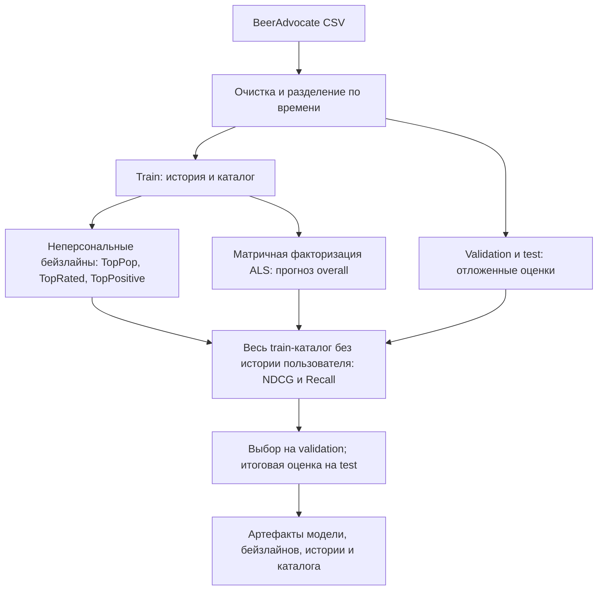
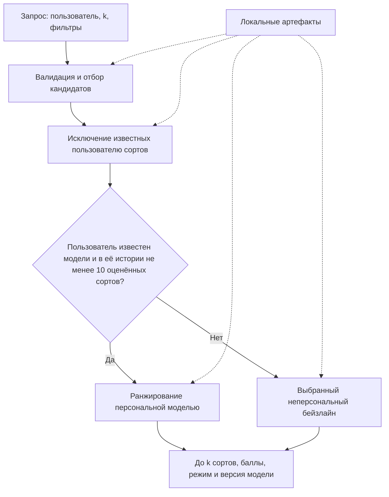

# ML System Design: beer4rec

**Итерация:** учебный MVP. **Версия:** 0.4, ДЗ1. **Дата:** 08.11.2026.

Требования ниже — допущения учебного проекта. Проверка модели на исторических данных
не заменяет будущий эксперимент с реальными пользователями.

## 1. Цели и предпосылки

### 1.1. Зачем идём в разработку продукта

#### Бизнес-цель и текущий процесс

[BeerAdvocate](https://www.beeradvocate.com/) — сообщество любителей пива: можно оставить
отзыв, почитать впечатления остальных и найти интересный сорт. На публичной главной
странице доступны общие подборки «Топ нового» и «В тренде»; пользователь самостоятельно
просматривает карточки и сопоставляет их со своим опытом.

Цель beer4rec — упростить выбор новых для пользователя сортов с высокой ожидаемой
персональной оценкой. Проектируемый результат — блок «Рекомендуем вам» в каталоге.

#### Почему предполагается польза от ML

В истории есть пользователь, сорт и пять отдельных оценок, по которым можно находить
сходство предпочтений. **Гипотеза:** персональная модель ранжирует интересные пользователю
сорта лучше, чем неперсональные способы ранжирования по популярности и оценкам;
её нужно проверить на отложенных данных.

#### Что считаем успехом

Для продукта важна доля выбранных рекомендаций, впоследствии оценённых не ниже 4.
Успех учебного MVP — превзойти лучший выбранный на validation неперсональный бейзлайн
по NDCG@10 при ранжировании всего доступного каталога на временной офлайн-проверке
из раздела 2.1; роста продуктовой метрики без онлайн-эксперимента не заявляем.

### 1.2. Бизнес-требования и ограничения

#### Типовой сценарий

Пользователь открывает рекомендации и при желании задаёт стиль и диапазон крепости.
Сервис возвращает до `k` новых для него сортов, ранжированных с учётом истории оценок.

#### Функциональные требования

Выдача содержит до 20 уникальных сортов, соблюдает фильтры и исключает уже оценённые.
Персональная модель используется, если пользователь ей известен и в её истории
есть не менее 10 оценённых сортов; для остальных — выбранный на validation
неперсональный бейзлайн. При нехватке кандидатов возвращается короткий или пустой
список; при фильтрации по крепости исключаются сорта, у которых она не указана.

#### Нефункциональные требования

Цели для будущего нагрузочного теста: p95 задержки до 200 мс при 10 запросах/с
в течение 5 минут, менее 1% ответов 5xx и до 4 ГБ RAM на CPU. Измерения проводятся
на прогретом сервисе с зафиксированными оборудованием и размером каталога.

#### Ограничения

Проект выполняется одним разработчиком на историческом датасете: текущие цены, наличие,
показы рекомендаций и покупки неизвестны. Инференс работает с локальными артефактами;
обучение и обновление истории выполняются пакетно.

### 1.3. Что входит в скоуп проекта и текущей итерации

- **MVP курса:** подготовка данных, EDA, сравнение неперсональных бейзлайнов с персональной моделью,
  top-k с фильтрами и fallback, HTTP-инференс и нагрузочный тест.
- **ДЗ1:** настройки репозитория, README и начальные разделы дизайн-документа;
  модели и сервис на схемах пока только запланированы.
- **За пределами MVP:** сайт и авторизация, онлайн-эксперимент, продажи и доставка,
  актуализация ассортимента, работа с текстами и обучение в реальном времени.
- **Дальнейшее развитие:** использование аспектных оценок, рекомендации новых сортов
  без истории, сбор обратной связи и мониторинг качества.

### 1.4. Предпосылки решения

Используется [CSV-зеркало BeerAdvocate][csv].

| Данные | Что известно |
| --- | --- |
| Объём | 1 586 614 отзывов, 33 387 пользователей с указанным профилем, 66 055 сортов |
| Метаданные | Название, пивоварня, 104 стиля и крепость (`beer_abv`) — процент алкоголя по объёму |
| Оценки | `overall`, `taste`, `aroma`, `appearance`, `palate`, обычно 1–5 с шагом 0,5 |
| Время | В скачанной версии: 22.08.1996–11.01.2012; крайние даты требуют проверки |
| Качество | 348 строк без пользователя, 67 785 с неизвестной крепостью, 7 с нулевыми оценками |
| Повторы | 14 786 повторных записей пары «пользователь — сорт» сверх первой |

Медиана истории — 3 отзыва на пользователя, но 10 700 пользователей оценили минимум
10 разных сортов. Основную гипотезу проверяем на пользователях с достаточной историей;
для остальных предусматриваем fallback.

Начальная очистка исключает строки без пользователя и с неположительными оценками;
для каждой пары до временного разбиения сохраняется самый ранний отзыв по `review_time`.
Неизвестная крепость не требует удаления отзыва; аспектные оценки отражают впечатление
пользователя, а не интенсивность горечи или аромата.

## 2. Методология

### 2.1. Постановка задачи

Построить систему персонального ранжирования: по прошлым оценкам пользователя
упорядочить ещё не оценённые им сорта из исторического каталога.

#### Бейзлайны и модель

Сравниваем персональную модель с неперсональными способами ранжирования, рассчитанными
по train. Основной ориентир выбирается по NDCG@10 на validation до открытия test.

| Бейзлайн | Как ранжирует сорта |
| --- | --- |
| TopPop | По числу пользователей, оставивших отзыв |
| TopRated | По средней оценке `overall`, сглаженной к общей средней; силу сглаживания выбираем на validation |
| TopPositive | По числу пользователей, поставивших `overall >= 4` |

**Первый вариант персональной модели** — матричная факторизация с обучением ALS
(Alternating Least Squares) на явных оценках `overall`. Используется вариант для
прогноза оценок 1–5; реализацию и параметры уточним после EDA. Аспектные оценки
рассматриваются как улучшение после сравнения с неперсональными бейзлайнами.

#### Валидация и метрики

- **Разбиение:** глобально по времени примерно 80/10/10; параметры выбираются на
  validation, финальное сравнение выполняется на test.
- **Кандидаты:** для каждого пользователя ранжируем весь каталог train-сортов,
  исключая оценённые им в train; набор не ограничивается его validation/test-отзывами.
- **Основная метрика:** NDCG@10 по полученной выдаче; известные позитивы — сорта
  с `overall >= 4` в соответствующем отложенном периоде, используется бинарная релевантность.
- **Группа проверки:** минимум 10 train-отзывов и хотя бы один test-позитив среди
  доступных кандидатов. Для validation действуют те же правила относительно validation-позитивов.
- **Сравнение:** одинаковые пользователи и кандидаты для всех бейзлайнов и модели;
  публикуются средняя NDCG@10, разницы, парные 95% bootstrap-интервалы разниц
  по пользователям и покрытие.
  Число допущенных к оценке пользователей и долю исключённых фиксируем в EDA.
- **Дополнительно:** Recall@10 по известным позитивам, MAE/RMSE прогноза `overall`
  по наблюдаемым оценкам для персональной модели, проверка фильтров и исключения истории.

Для офлайн-проверки успех означает, что нижняя граница парного 95% bootstrap-интервала
разницы средней NDCG@10 на test (модель минус выбранный на validation неперсональный
бейзлайн) выше нуля. Если интервал включает ноль, выигрыш не подтверждён.

Неоценённые сорта не получают положительного вклада в метрики, но это не означает,
что они не понравились пользователю: полнота разметки и выбор того, что оценивать,
ограничивают выводы офлайн-проверки. Обучение, популярность, агрегаты и история
строятся только по train; аспекты и текст будущего отзыва не используются как признаки.
История фиксируется на границе обучения; `k` ограничивается только числом доступных
кандидатов после исключения истории, а не числом отложенных отзывов пользователя.

### 2.2. Блок-схемы решения

#### Подготовка и сравнение

#### Выдача рекомендаций

### 2.3. Следующие этапы

ДЗ2 — EDA и уточнение очистки и протокола оценки; ДЗ3 — обучение и сравнение решений,
анализ ошибок и план пилота; ДЗ4 — инференс и нагрузочная проверка.

## Источники

- [BeerAdvocate: публичная главная страница](https://www.beeradvocate.com/).
- [Описание датасета, Stanford SNAP][snap]; [используемое CSV-зеркало][csv].
- [Шаблон дизайн-документа](https://github.com/IrinaGoloshchapova/ml_system_design_doc_ru/blob/main/ML_System_Design_Doc_Template.md).
- [Условие ДЗ1](https://gist.github.com/pacifikus/47424379293e0874859354ecd130ba13).

[snap]: https://snap.stanford.edu/data/web-BeerAdvocate.html
[csv]: https://www.kaggle.com/datasets/rdoume/beerreviews
